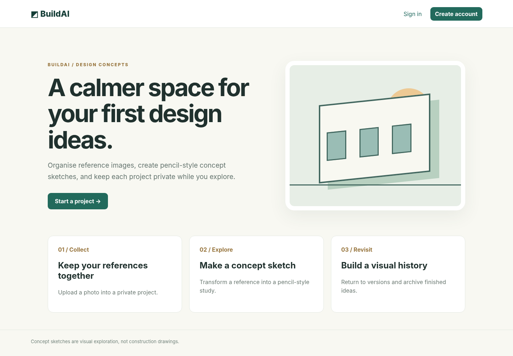
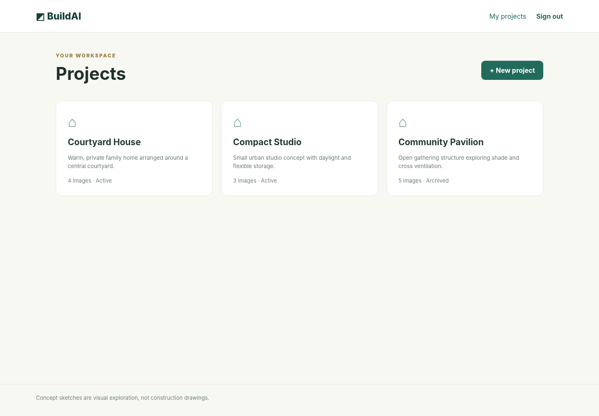
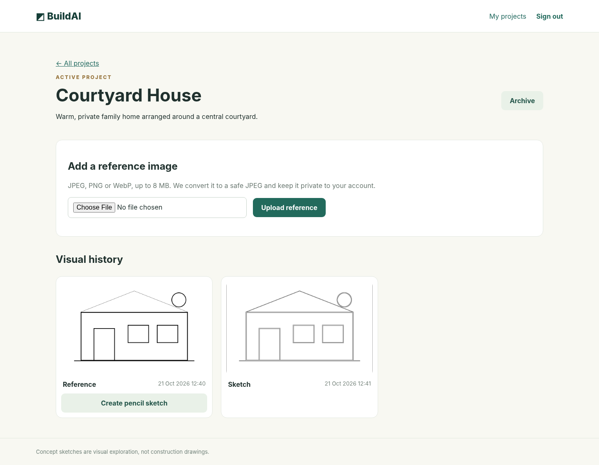
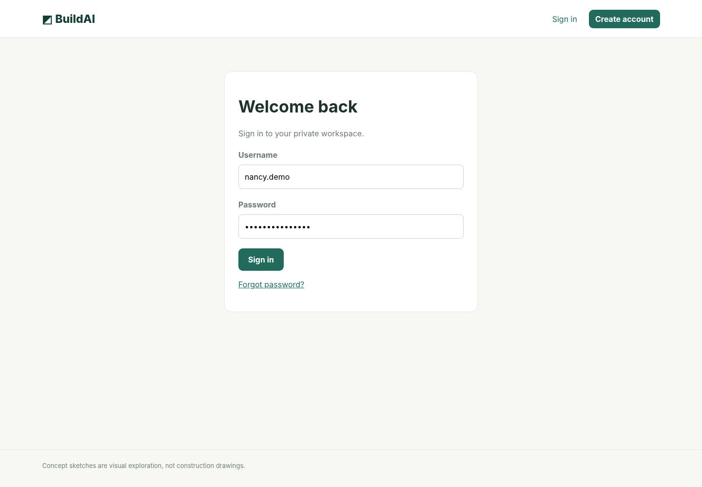

# BuildAI — Private Design Concept Workspace

BuildAI is a responsive Django web application for organising architectural and design reference images, creating pencil-style concept studies, and keeping project work private inside authenticated user accounts.

The current version focuses on secure project management and deterministic image processing. Despite the project name, **generative AI / text-to-image is not yet implemented**. The pencil-style output is created through image-processing filters.

## Key Features

- Responsive web interface for desktop, tablet, and mobile
- User registration with email verification
- Password reset support
- Six-digit email sign-in verification code
- Login attempt rate limiting
- Private user-specific projects
- Project creation, archiving, and restoration
- Secure image uploads with size and format validation
- Private image storage outside public static files
- Authenticated image access restricted to the project owner
- Pencil-style concept sketch generation from uploaded references
- Visual history of reference images and generated studies

## Technology Stack

- Python
- Django
- Pillow
- HTML
- CSS
- SQLite
- Django authentication, sessions, CSRF protection, and email utilities

## Screenshots

### Landing Page


### Projects Workspace


### Project Detail


### Sign In


> Screenshots use sample content to demonstrate the interface without exposing real user information.

## Project Structure

```text
BuildAI/
├── config/
│   ├── settings.py
│   ├── urls.py
│   └── wsgi.py
├── studio/
│   ├── migrations/
│   ├── static/studio/
│   ├── templates/studio/
│   ├── forms.py
│   ├── models.py
│   ├── tests.py
│   └── views.py
├── manage.py
├── requirements.txt
├── setup_windows.bat
└── start_windows.bat
```

## Local Setup

### Windows quick setup

1. Install Python 3.12 or newer.
2. Clone or download the repository.
3. Run:

```text
setup_windows.bat
```

4. Start the app with:

```text
start_windows.bat
```

5. Open `http://127.0.0.1:8000/`.

### Manual setup

```bash
python -m venv .venv
pip install -r requirements.txt
python manage.py migrate
python manage.py runserver
```

In local development, verification emails and sign-in codes are written to the server console by default.

## Security Highlights

- Passwords are handled through Django authentication and hashing.
- CSRF protection and authenticated sessions are enabled.
- New accounts require email verification.
- Sign-in uses a second six-digit email code.
- Repeated failed login attempts are temporarily rate-limited.
- Uploaded images are validated, re-encoded, renamed randomly, and stored outside public static files.
- Image requests verify ownership before serving private files.
- Session cookies are HTTP-only and stricter production settings are enabled when debug mode is disabled.

## Production Notes

The included configuration is intended for local development. Before public deployment:

- Set a strong `STUDIO_SECRET_KEY`.
- Disable debug mode.
- Configure allowed hosts and HTTPS.
- Use a production WSGI server.
- Configure a real email provider.
- Use a durable production database.
- Add shared rate limiting and abuse controls.
- Set up backups, monitoring, and an image-retention policy.
- Run `python manage.py check --deploy`.

## Current Scope & Future Direction

The current pencil-sketch feature uses deterministic image processing rather than generative AI. A future version could connect to a real image-generation model using background jobs, usage limits, consent controls, and clear output labelling.

## Project Purpose

BuildAI was developed as a practical Information Technology Management project exploring how a secure, responsive digital workspace can support early-stage visual ideation while protecting user accounts and uploaded content.

## Author

Nancy Samuella Asantewaa Asante
